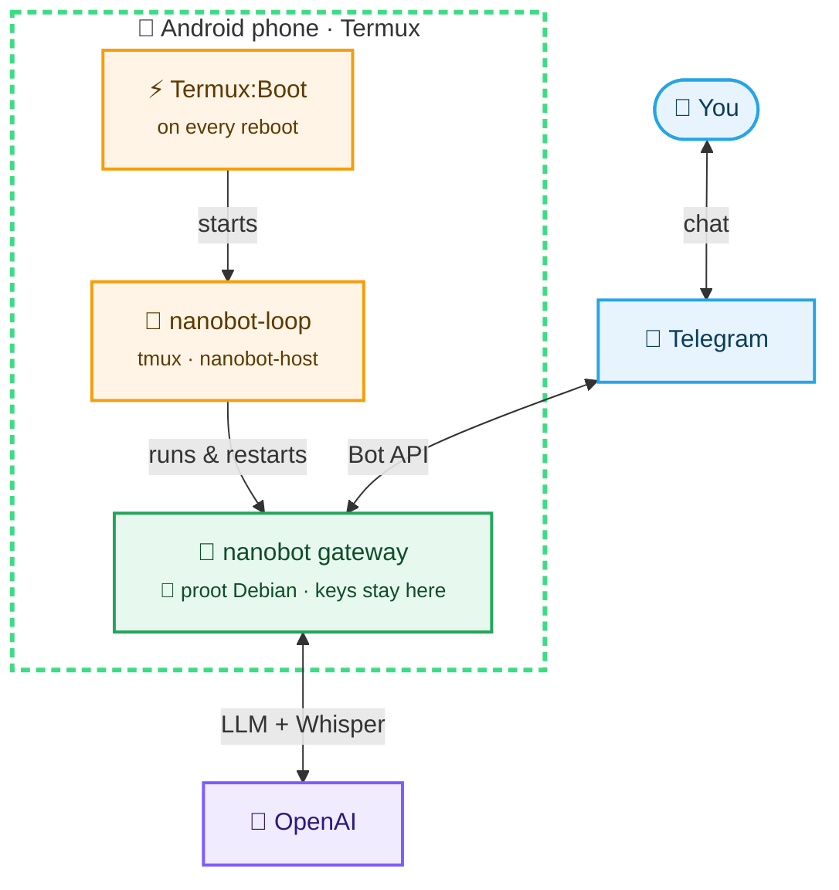
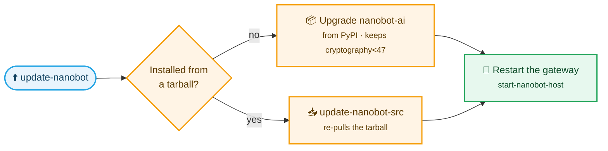

# 🤖📱 Nanobot on Android


Run [Nanobot](https://pypi.org/project/nanobot-ai/) as a Telegram bot on your phone. It runs 24/7 and starts again by itself after a reboot.

📝 Full story: [the setup write-up](https://github.com/gianfrancodemarco/site/blob/main/content/posts/nanobot-android-termux.md)



## 1️⃣ Install the apps

Install both APKs from the **same release**, so their signing keys match (Android 14+ needs this for boot). Install Termux first, then open each app once.

| App | Download |
| --- | --- |
| **Termux** | [termux-app_matching-key_universal-debug.apk](https://github.com/oswaldlow/termux-boot/releases/download/v0.8.1-boot-fix/termux-app_matching-key_universal-debug.apk) |
| **Termux:Boot** | [termux-boot-app_v0.8.1-boot-fix_debug.apk](https://github.com/oswaldlow/termux-boot/releases/download/v0.8.1-boot-fix/termux-boot-app_v0.8.1-boot-fix_debug.apk) |

> [!IMPORTANT]
> You need **64-bit** Termux: `uname -m` must print `aarch64`. Then allow Termux to run in the background in your battery settings.

## 2️⃣ Run the installer

In Termux:

```bash
pkg update -y && pkg install -y git tmux
tmux new -s setup
```

Then, inside tmux:

```bash
git clone https://github.com/gianfrancodemarco/nanobot-android-termux.git
cd nanobot-android-termux
./setup.sh
```

> [!TIP]
> Paste the two blocks separately. Anything pasted after `tmux new` ends up inside tmux.

Setup asks for your 🔑 **OpenAI API key** and 🤖 **Telegram bot token**. Your secrets stay on the phone.

## 3️⃣ Start the bot

```bash
~/bin/start-nanobot-host
```

Detach with `Ctrl+B` then `D`. After a reboot, Termux:Boot starts the bot by itself.

## 🧰 Everyday commands

| I want to… | Run |
| --- | --- |
| ▶️ Start or restart the bot | `~/bin/start-nanobot-host` |
| ⬆️ Update nanobot | `~/bin/update-nanobot` |
| 👀 Watch the logs | `tail -f ~/nanobot-logs/gateway.log` |
| 🐞 Debug a crash | `~/bin/debug-gateway` |
| 📦 Share a log report | `~/bin/collect-nanobot-logs` |
| ⚙️ Edit the config | `proot-distro login debian`, then edit `/root/.nanobot/config.json` |

## ⬆️ Updating

```bash
~/bin/update-nanobot
```



**No need to stop the bot first.** It keeps running during the upgrade, then the script restarts it: the old `nanobot-host` session is killed and a fresh one starts on the new version. Run it from a plain Termux shell, not from inside the `nanobot-host` session (detach with `Ctrl+B` then `D`).

It prints the nanobot version before and after, then attaches to the new session. Your config and keys aren't touched.

The `cryptography<47` pin matters: newer wheels crash under proot (see [`rc=132`](#-troubleshooting)).

> [!NOTE]
> `update-nanobot` updates **nanobot**, not this repo's scripts. To get new scripts, run `git pull && ./setup.sh` in the repo. Setup keeps your config and secrets.

## 🩺 Troubleshooting

<details>
<summary><b>The gateway restarts every ~10 seconds</b></summary>

1. Run `~/bin/debug-gateway` and watch for errors.
2. In Debian, check `/root/.nanobot/logs/gateway.log` for Telegram or API errors.
3. Test the token: `curl -s "https://api.telegram.org/bot<TOKEN>/getMe"` should return `"ok":true`.

</details>

<details>
<summary><b><code>rc=132</code> (SIGILL)</b></summary>

A native wheel is crashing under proot. The known case is `cryptography` 50.x. Setup and `update-nanobot` pin it below 47. On an older install, run `pip install "cryptography<47"` inside `/root/nanobot-env`.

For another culprit, run `python -c "import <module>"` for each dependency and see which one dies.

</details>

<details>
<summary><b><code>terminated with signal 4</code></b></summary>

This line only means the proot session ended. The real reason is in the lines above it.

</details>

<details>
<summary><b>proot misbehaves</b></summary>

From a plain Termux shell (not inside `setup.sh`), run:

```bash
pkg upgrade -y proot proot-distro
```

</details>

<details>
<summary><b>Sharing a debug report</b></summary>

```bash
tmux kill-session -t nanobot-host 2>/dev/null   # optional
~/bin/collect-nanobot-logs
```

Keys and tokens are redacted. The report goes to `~/nanobot-logs/debug-report-*.txt`.

</details>

## 🔧 Advanced

<details>
<summary><b>Setup options</b></summary>

Set these before `./setup.sh`:

| Variable | Effect |
| --- | --- |
| `NANOBOT_DISTRO=nanobot` | Use a separate Debian rootfs and leave `debian` untouched. Then use that name with `proot-distro login`. |
| `NANOBOT_SOURCE_URL=<url>` | Install from a source tarball instead of PyPI. `update-nanobot` then re-pulls the tarball. |
| `NANOBOT_RECREATE_VENV=1` | Delete and recreate `/root/nanobot-env`. |

Without a terminal, setup skips the key prompts, so edit the config afterwards. The defaults are model `gpt-4.1-mini` and Whisper language `it`.

</details>

<details>
<summary><b>What <code>setup.sh</code> does</b></summary>

1. Checks for aarch64 Termux.
2. Installs `proot-distro`, `tmux`, `git` and `curl`.
3. Installs the Debian rootfs if it's missing.
4. Creates `/root/nanobot-env` and installs nanobot.
5. Writes `/root/.nanobot/config.json` from the example if none exists.
6. Asks for the API key and bot token.
7. Installs the scripts in `~/bin` and the Termux:Boot entry.

Everything is logged to `~/nanobot-logs/setup.log`.

</details>

<details>
<summary><b>Scripts</b></summary>

| Script | Role |
| --- | --- |
| `nanobot-loop` | Keeps restarting the gateway |
| `start-nanobot-host` | (Re)starts the `nanobot-host` tmux session and attaches |
| `00-start-nanobot` | Termux:Boot entry |
| `update-nanobot` | Upgrades nanobot and restarts the gateway |
| `update-nanobot-src` | Re-pulls the source tarball and restarts the gateway |
| `debug-gateway` | Runs the gateway in the foreground with checks |
| `collect-nanobot-logs` | Writes a redacted log report |

</details>

## 📄 License

MIT, see [LICENSE](LICENSE).
